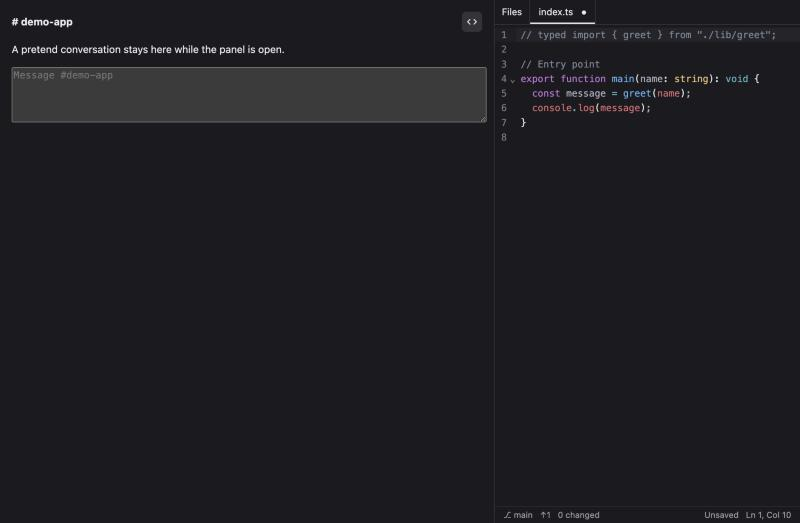
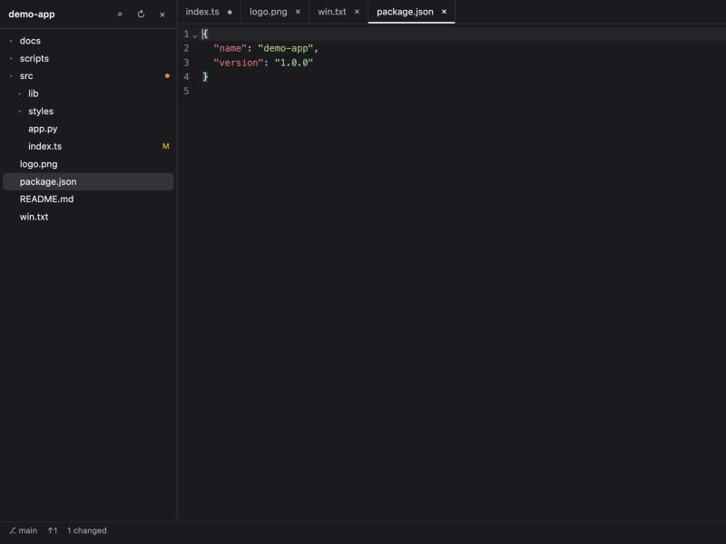

# Code Lite for Buzz

A lightweight code editor that lives inside Buzz, right beside your conversations.

> **Prototype.** Code Lite edits real files, so try it on a scratch branch first.
> It has been tested against real git and file operations, but it's still early.



## Features

- **Works beside your chat.** Edit in a side panel next to a channel, or use the full page.
- **A real editor.** Built on CodeMirror, with syntax highlighting for about 18 languages,
  multiple cursors, undo and find.
- **File tree and tabs.** Git-aware, with changed files marked.
- **Quick open.** Press ⌘P to jump to any file.
- **Safe alongside agents.** Files an agent changes update automatically. If you have unsaved
  edits, you choose which version to keep, so nothing is silently overwritten.
- **Careful saves.** Saves keep file permissions, symlinks and Windows line endings, then read
  the file back to confirm it worked.
- **Your work stays put.** Open files and unsaved changes survive closing the panel.



## Install

Requires Buzz 1.0 on the desktop.

On a Mac, run:

```sh
open 'buzz://plugin-install?repository=nickhenggeler%2Fbuzz-code-lite&ref=main&path=dist'
```

Or open **Settings → Plugins → Manage plugins**, add the repository
`nickhenggeler/buzz-code-lite`, then choose the `dist` folder.

Buzz doesn't pull updates by itself. To move a plugin you installed from a folder over to
this repository, save your work, remove it, then install it from here.

### Access it needs

Code Lite asks for file access and for permission to run `git`, `tee` and `find`. These run with
your full user access, which is what lets it save files. Buzz shows this before you install.

## Use it

1. Click the `<>` button in a channel header, click **Code** in the top bar, or open **Code**
   in the sidebar.
2. Pick a repository in `~/.buzz/REPOS`, or enter the folder of any local git repository.
3. Choose a file and start editing.

| Action | Shortcut |
| --- | --- |
| Save | ⌘S |
| Go to file | ⌘P |
| Find in file | ⌘F |

Only one view edits at a time. If Code Lite is already open elsewhere, choose **Use it here**.

## Limits

- It works on local git repositories only, so repositories need to be cloned first.
- It has no commit or push yet.
- It can't create, rename or delete files yet.
- It has no search across files, terminal panel or code intelligence yet.
- Files over 5 MB and binary files don't open.
- Files that mix Windows and Unix line endings are normalized when saved.

## Roadmap

1. Changed-files view, commit and push
2. New, rename and delete
3. Search across files
4. Ask an agent about the selected code

## Development

The source is in `src/`. Buzz loads the built plugin from `dist/`, so commit it after building.

```sh
npm install
npm run build
npm test
```

The tests run the real file and git layer against real programs. To try the interface with
sample data, build it, serve this folder and open `tests/preview.html`. Add `?panel=1` for the
side panel.

## Related

[Projects for Buzz](https://github.com/nickhenggeler/buzz-projects-plugin) browses your
community's projects and repositories.

## License

[Apache-2.0](LICENSE). Bundled third-party licenses are in
[THIRD-PARTY-NOTICES.md](THIRD-PARTY-NOTICES.md). This is an independent community plugin, not an
official Block project.
